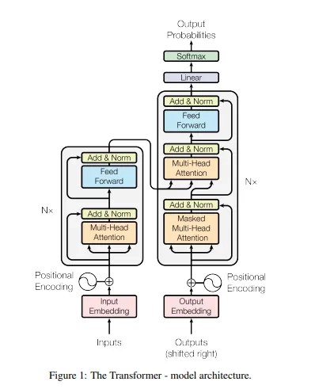
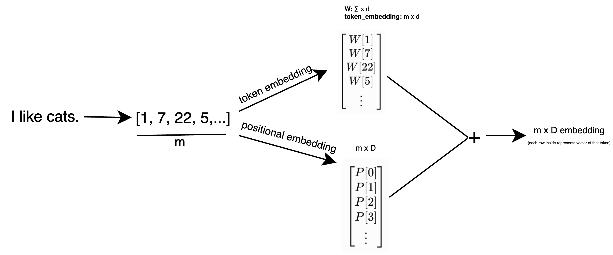
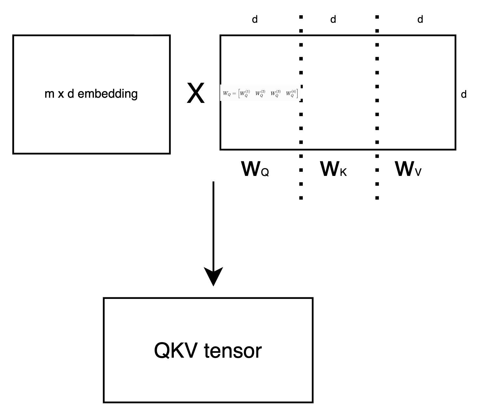
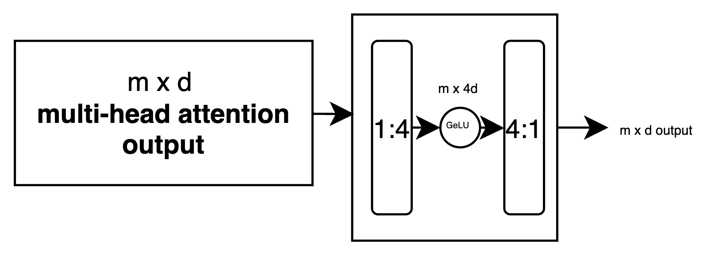

# Overview
These are my full notes on developing an LLM from scratch. It involves building the model architecture, explaining each component of the model, and training it on a basic dataset. The goal is to understand the building blocks of LLMs and how they are trained to generate text.

**Project Link:** https://github.com/kanjurer/emergence

# Architecture
The following is LLM architecture derived from [Attention is All You Need](https://arxiv.org/abs/1706.03762) paper.

## Components of LLM

### Embedding
class: [TokenAndPositionEmbedding](https://github.com/kanjurer/emergence/blob/0e51f063bb10358e637a6537759a3d1d7912d07d/src/emergence/models/transformer/embeddings.py#L5)

- Trainable component of LLM that maps tokens into a vector space.

### Attention
class: [CausalSelfAttention](https://github.com/kanjurer/emergence/blob/0e51f063bb10358e637a6537759a3d1d7912d07d/src/emergence/models/transformer/attention.py#L8)

- Q, K, V are $m \times d$ matrices.
- Attention scores of the $i^{th}$ head $(S_i)$ $m \times m$ matrix:
$$
S_i = \frac{Q_iK_i^T}{\sqrt{d/h}}
$$
- We divide by $\sqrt{d/h}$ because each head operates on vectors of dimension $d/h$.
- Next, apply softmax to get attention weights $(A_i)$ $m \times m$ matrix:
$$
A_i = \operatorname{softmax}(S_i)
$$
- Then, get attention output $(O_i)$ $m \times d/h$ matrix:
$$
O_i = A_iV_i
$$
- Finally, concatenate the outputs of all heads to get the final output $(O)$ $m \times d$ matrix.

> **Causal Mask**: Although we can directly use Attention scores to compute "attention weights" by applying softmax, we need to apply something called a **Causal Mask** to ensure that the model does not attend to future tokens, which is a fancy term for "please do not cheat and look at the next token when predicting the current token". Turns out, a lower triangular matrix is a good way to implement this.

### MLP
class: [MLP](https://github.com/kanjurer/emergence/blob/0e51f063bb10358e637a6537759a3d1d7912d07d/src/emergence/models/transformer/mlp.py#L7)

### Transformer Block
class: [TransformerBlock](https://github.com/kanjurer/emergence/blob/0e51f063bb10358e637a6537759a3d1d7912d07d/src/emergence/models/transformer/block.py#L9)

If x is the embedding input to the transformer then,
$$
x' = x + \operatorname{MultiHeadAttention}(\operatorname{LayerNorm}(x))
$$

$$
Output = x' + \operatorname{MLP}(\operatorname{LayerNorm}(x'))
$$

> An alternative approach could be
> $$
> Output = \operatorname{MLP}(\operatorname{LayerNorm}(\operatorname{MultiHeadAttention}(\operatorname{LayerNorm}(x))))
> $$
> But this approach is not as effective as the first one, which uses residual connections. The residual connections help in training deep networks by allowing gradients to flow through the network more easily. [Paper](https://arxiv.org/pdf/1512.03385)

### Model
class: [TransformerModel](https://github.com/kanjurer/emergence/blob/0e51f063bb10358e637a6537759a3d1d7912d07d/src/emergence/models/transformer/model.py#L9)

Now putting it all together, where L is number of transformer blocks, d is the embedding dimension, and h is the number of attention heads, we have the following equations for the model:
$$
\begin{aligned}
X_0 &= E_{\text{token}}(\text{Token IDs}) + E_{\text{position}}(\text{Positions}) \\[6pt]
X'_\ell &= X_\ell + \operatorname{MHA}_\ell(\operatorname{LN}(X_\ell)) \\[6pt]
X_{\ell+1} &= X'_\ell + \operatorname{MLP}_\ell(\operatorname{LN}(X'_\ell)),
\quad \ell = 0, 1, \ldots, L-1 \\[6pt]
\text{Logits} &= \operatorname{Linear}(\operatorname{LN}(X_L))
\end{aligned}
$$

## Training LLM
Relevant python files: [Trainer, Checkpointing, Optimizer](https://github.com/kanjurer/emergence/tree/main/src/emergence/training) and [Datasets, Tokenizer](https://github.com/kanjurer/emergence/tree/main/src/emergence/data)

- We first use a dataset and tokenize it and text positions to numerical IDs.
- Then we feed these into model to get an output, and compute the loss to compute gradient and update the model parameters using AdamW optimizer.
- We batch the dataset to speed up training.
- We go through the dataset multiple times (epochs) to improve the model performance.

### Cross Entropy Loss
- On a higher level, we compute the loss between predicted output and the actual output.
- Remember, the model takes in a sequence of tokens and predicts the next token in the sequence. So, we compute the loss between the predicted token and the actual next token in the sequence. 

### AdamW Optimizer
- This is used to perform gradient descent (like we do using SGD). 
- When we compute the loss, we also compute the gradients which updates the `.grad` attribute of the model.
- Then we use the optimizer to update the model parameters using these gradients.

