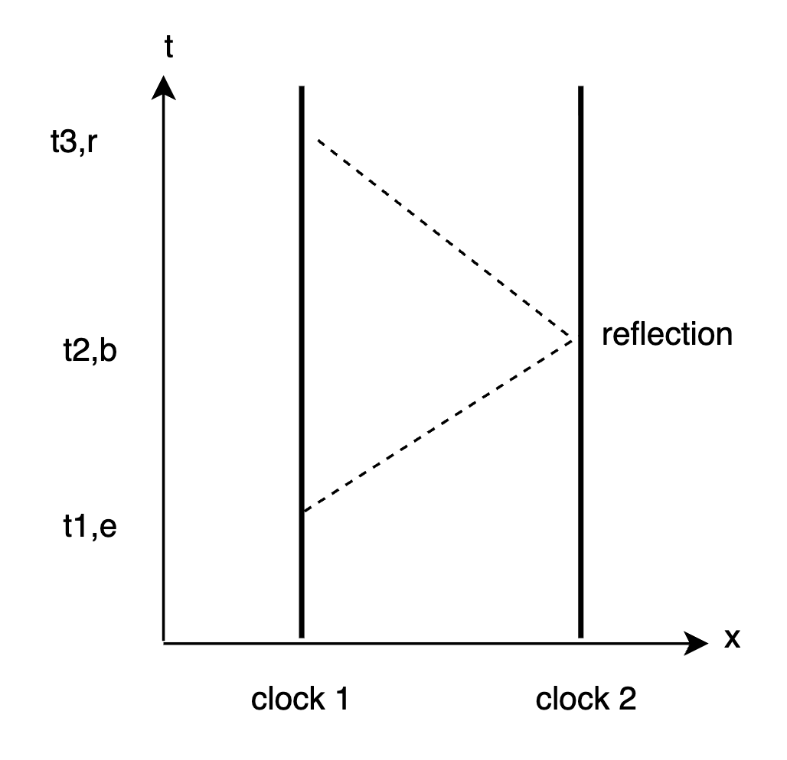

# Course Details
Link: https://ocw.mit.edu/courses/8-962-general-relativity-spring-2020/download/

# Lecture 1
**Spacetime**
- A manifold of events endowed with a metric that allows us to measure distances and angles.

**Manifold**
- A set of points with well-understood connected properties.

**Event**
- When and where something happens.
- Labelled with coordinates but exist independently of the coordinate system.

**Metric**
- A notion of distance between events on a manifold.
- Without this, a manifold has no notion of distance encoded in it.

**Special Relativity**
- Simplest theory of spacetime.
Corresponds to general relativity in no-gravity limit.

### Einstein's Synchronization Procedure

- A method to synchronize clocks at different locations using light signals.
- The condition is: 
$$
t_{2,b} = \frac{t_{1,e} + t_{3,r}}{2}
$$

### Position
Notation: $ \Delta \vec{x} = (\Delta t, \Delta x, \Delta y, \Delta z) $

> Distance, points P, Q itself are independent of the coordinate system. The coordinates of P and Q depend on the coordinate system.

